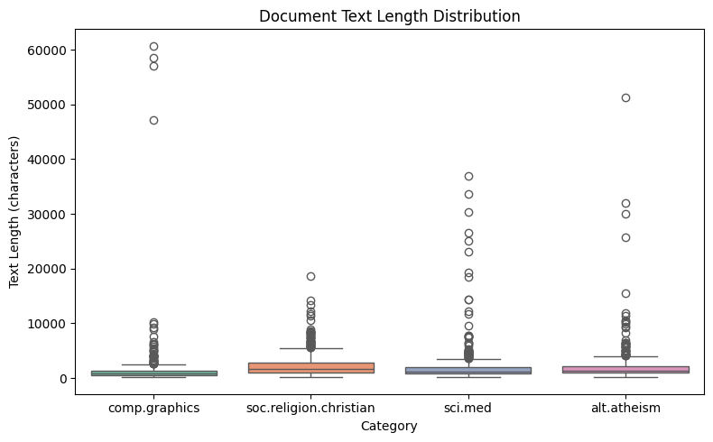
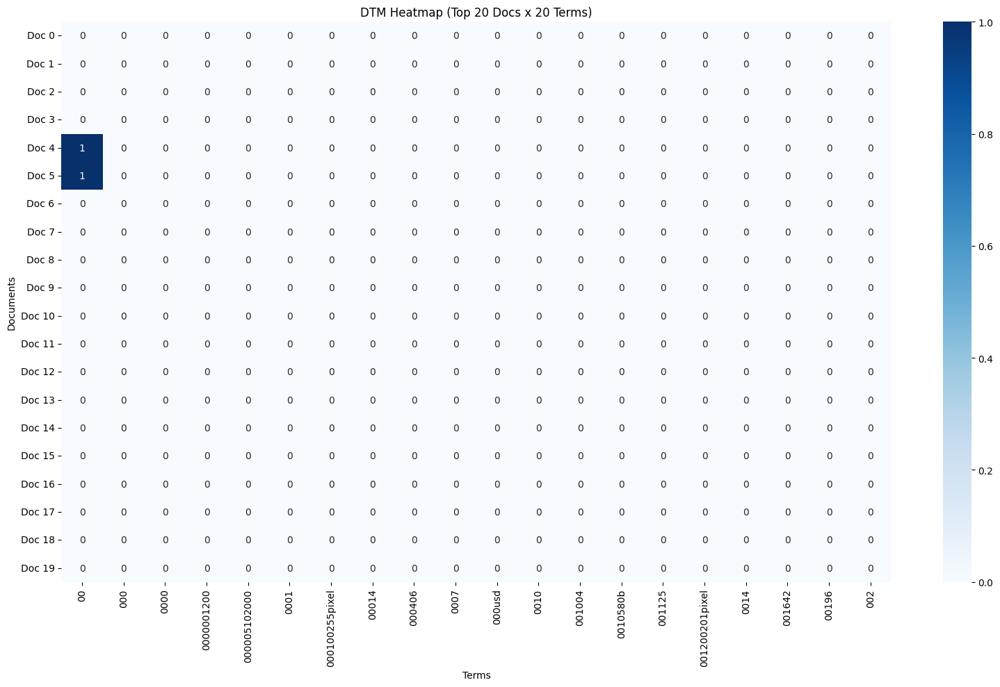
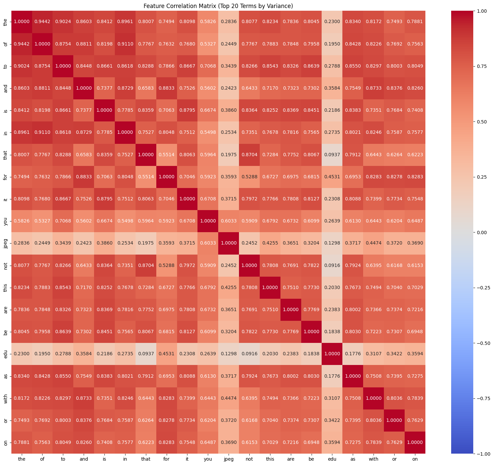
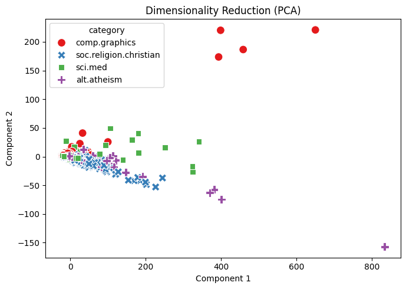

# Agentic Pipeline Report — Data Mining Lab 1

## 1. Data Exploration and Data Quality

I started by loading four categories from the 20 Newsgroups dataset: `alt.atheism`, `comp.graphics`, `sci.med`, and `soc.religion.christian`, using `load_dataset_tool` (`load_dataset_13`). The dataset contained 2,257 documents, including 480, 584, 594, and 599 documents from the four categories, respectively. I first inspected the dataset (`inspect_15`) and then checked for missing text values and duplicate documents using `check_missing_tool` and `check_duplicates_tool`. Both checks returned zero missing values and zero duplicates (`check_missing_16`, `check_duplicates_17`), so no documents were removed. Next, I used `describe_data_tool` (`describe_18`) to examine the distribution of document lengths. The average document length was 1,992.96 characters, while the median was 1,235 characters. The box plot also showed several unusually long documents, with the maximum reaching 60,713 characters. This suggests that document lengths were unevenly distributed, with a relatively small number of much longer documents.

## 2. Document-Term Matrix and Feature Filtering

I kept the full dataset without optional sampling and used `build_dtm_tool` to construct the Document-Term Matrix (`dtm_19`). The matrix contained 2,257 documents and 35,788 terms, with 365,886 non-zero entries and a sparsity rate of 99.547%. Most terms therefore appeared in only a small proportion of documents. I then used `term_frequency_tool` (`term_freq_20`) to examine word frequencies across the dataset. Common English words such as "the" (29,825 occurrences), "of" (17,660), and "to" (17,222) appeared most frequently. I also generated a 20 × 20 DTM heatmap (`dtm_heatmap_21`) to examine a small part of the matrix. As expected from the sparsity rate, most entries in the heatmap were zero. After that, I ran `variance_filter_tool` with `threshold=0.0` (`variance_filter_22`). All 35,788 terms were retained, so this threshold did not remove any features. Finally, I used `visualize_result_tool` to plot the variance-filtering result and compare the selected terms.

## 3. Correlation Analysis

To examine the relationship between word frequencies and document categories, I selected `sci.med` as the target class and applied both Pearson and Spearman correlation methods (`pearson_filter_23`, `spearman_filter_24`). In both analyses, "pitt", "gordon", and "geb" were among the most positively correlated terms. For example, "pitt" had a Pearson correlation of 0.3795 and a Spearman correlation of 0.3950. In contrast, terms such as "god" and "christian" were negatively correlated with `sci.med`. I then used `feature_correlation_matrix_tool` (`feature_corr_25`) to examine the relationships among 20 high-variance terms. The heatmap showed that many common English words were strongly correlated with one another. For example, the correlation between "the" and "of" was 0.9442. However, some highly correlated terms, such as "pitt" and "gordon", are not clearly medical terms. Therefore, these correlations should not be interpreted as direct measures of medical relevance.

## 4. Frequent Pattern Mining and Dimensionality Reduction

For frequent pattern mining, I used `mine_patterns_tool` on the `sci.med` category with `filtering_method="term_frequency"`, `algorithm="topk"`, and `k=10` (`patterns_26`). The analysis returned ten patterns, including "mass", "easy", and "advance", each with a support count of 23. All ten returned patterns were single-item patterns, so this result did not provide evidence of multi-term co-occurrence patterns. Next, I used `reduce_dimensions_tool` to apply PCA to the DTM, with `n_components=2` and `random_state=42` (`reduction_27`). The first principal component explained 65.94% of the variance, while the second explained 4.33%, giving a combined explained variance of 70.27%. In the scatter plot, most documents were concentrated near the origin, while a few documents had much larger component scores. The four categories also overlapped considerably, meaning that the first two principal components did not clearly separate the document categories.

## 5. Label Binarization and Document Similarity

Finally, I used `binarize_labels_tool` to convert the `category_name` column into one-hot encoded labels (`binarize_28`). This produced a binary matrix containing 2,257 rows and four columns, one for each category. I then applied `cosine_similarity_tool` to Documents 0 and 1 (`cosine_sim_29`). Both documents belonged to `comp.graphics`, and their cosine similarity was 0.3532. This indicates some overlap in their word-frequency vectors, but belonging to the same category does not necessarily mean that two documents have highly similar content. Overall, I completed the pipeline from data exploration and feature analysis to pattern mining, dimensionality reduction, label encoding, and document similarity. The results also reminded me that different methods describe different aspects of the same dataset, and their outputs need to be interpreted according to what each method actually measures.