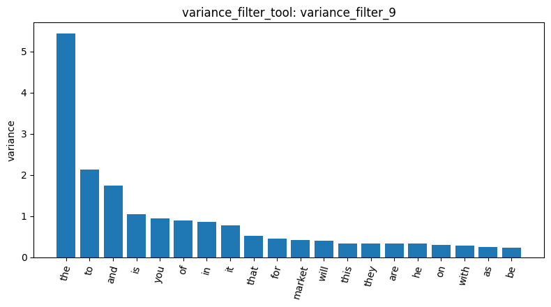
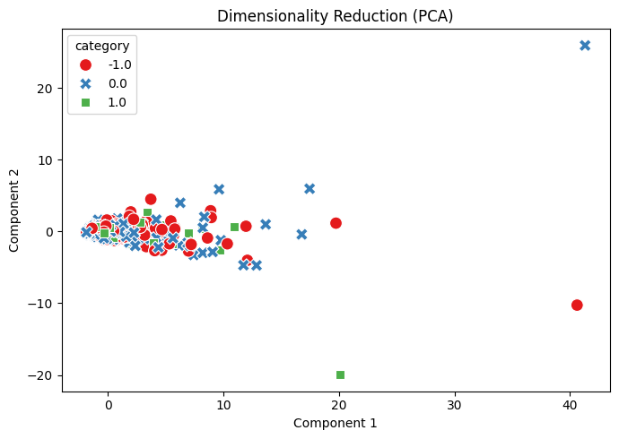
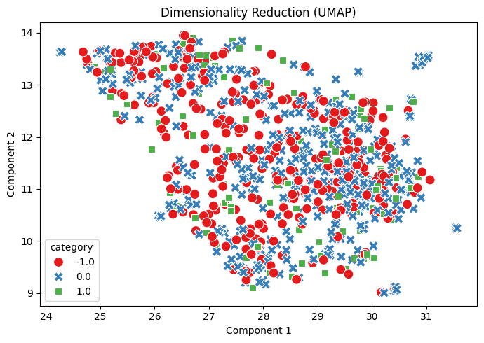

# Homework Report — Reddit Financial Sentiment Analysis

For this homework, I used the AI Agent and the data mining tools developed in AgentDev to analyze a new Reddit stock sentiment dataset. The dataset contains 847 posts classified into three sentiment categories: 315 negative, 423 neutral, and 109 positive (`load_dataset_1`). I first checked the data quality and found no missing values, although 34 records were flagged as duplicates (`check_missing_2`, `check_duplicates_4`). Since the dataset was relatively small, I kept all 847 documents without additional sampling. I then converted the text into a document-term matrix with 4,346 features and approximately 99.53% sparsity (`dtm_6`).

When I first checked the term frequency and variance results, I noticed that most of the top words were common English words like "the," "to," and "and" (`term_freq_7`, `variance_filter_9`). These words appeared frequently, but they did not tell me much about financial sentiment. I wanted to see whether a different filtering method could give more useful results, so I compared term frequency and TF-IDF using the same negative sentiment category and Top-K setting (k=100). The term frequency results included words such as "calls," "lot," and "actually" (`patterns_13`), while TF-IDF returned more finance- and policy-related terms, including "trump," "china," "market," and "tariffs" (`patterns_18`). I think TF-IDF gave me more meaningful terms for understanding what people were discussing, although these words may not necessarily help distinguish negative sentiment from other categories.

**Figure 1. Top 20 Terms by Variance**

After seeing the TF-IDF results for negative sentiment, I wanted to check whether the same words also appeared in other categories. I kept the filtering method and Top-K setting unchanged and ran the analysis for neutral and positive posts (`patterns_19`, `patterns_20`). I found that words like "market," "just," and "like" appeared frequently across different sentiment categories. For example, "market" had a support of 23 in negative posts and 37 in neutral posts, while "good" appeared in all three categories but was relatively more common in positive posts. This made me realize that a word can be related to financial topics without being specific to one sentiment. Also, because the three categories have different numbers of documents, comparing support counts alone may not be enough to judge which words are more useful for sentiment analysis.

I also used PCA and UMAP to see whether the Reddit posts would form separate groups based on sentiment. In the PCA results, the first two components explained 31.99% of the total variance, but most negative, neutral, and positive posts overlapped (`reduction_14`). UMAP showed a different distribution, but the three sentiment categories were still mixed together (`reduction_15`). From this homework, I learned that the tools can work on a new dataset, but getting results does not always mean the features are useful for the question I want to answer. In particular, identifying words related to financial topics is different from finding words that can distinguish sentiment.

**Figure 2. PCA — Reddit Sentiment Distribution**

**Figure 3. UMAP — Reddit Sentiment Distribution**

